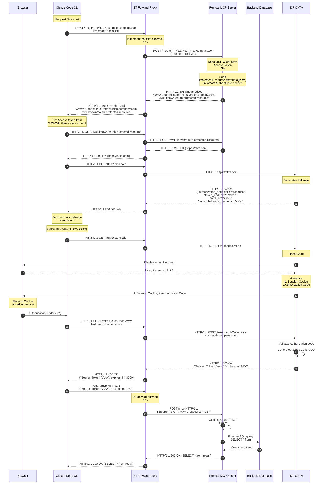

- [Flow](#flow)
-- [Protected Resource Metadata (PRM)](#prm)


<a name=flow></a>

## Flow


<a name=prm></a>

## Protected Resource Metadata (PRM)
- For very 1st time when AI Agent(MCP Client) connects to MCP server(via zftp), using <code>HTTP POST<code>, MCP server finds request does not have valid access token, then MCP server sends PRM in <code>WWW-Authenticate</code> header.
```
{
  "resource": "https://mcp.company.com",
  "authorization_servers": ["https://auth.company.com"]
}
```
- It tells AI Agent(Eg Claude Code) which authorization server can issue tokens for this MCP resource.