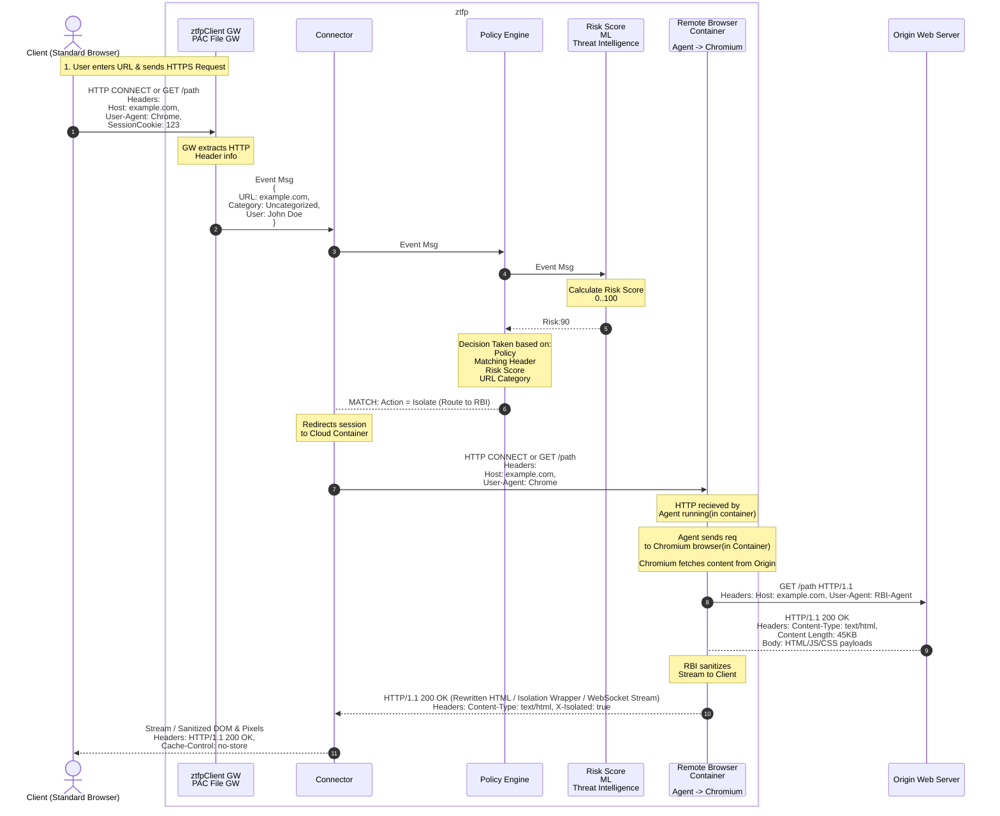

- [Flow](#Flow)
    - [How Policy Engine decides to Isolate?](#How)
    - [Is the container already running?](#container)
    - [How Risk Score is Calculated?](#RiskScore)

# RBI
- RBI is per website(eg: malware, phishing). All web traffic from browser is never isolated. Rendering every web page via remote containers consumes massive cloud compute, bandwidth, and memory resources.
- RBI is triggered based on RISK SCORE and URL CATEGORIZATION.
- Examples of Malware & Phishing Categories that Trigger RBI:
** Newly Registered Domains (NRDs): Domains registered within the last 7 to 30 days. Attackers frequently spin up fresh domains for spear-phishing or watering-hole attacks.
** Uncategorized / Parking Domains: Sites that have no threat intelligence history yet. Because they are unknown, they are treated as high-risk.
** Phishing Sites: Eg: sites mimicking corporate login portals. eg: login-microsoft.in

<a name=Flow></a>

## Flow


<a name=how></a>

### How Policy Engine decides to Isolate?
**if any of below categories is satisfied:**

- if target URL(retrieved from [Host Header](https://code-with-amitk.github.io/Networking/OSI-Layers/Layer-7/HTTP/HTTP%20Headers.html#HostHeader)) is Uncategorized/Newly Registered/high-risk categories (e.g: Phishing, Malware).
- if user belongs to protected groups eg(Finance) he gets isolated for high-risk sites
- Unmanaged devices(BYOD) frequently trigger default RBI for all web traffic

<a name=container></a>

### Is the container already running?
- Yes. zftp proxy maintains Pool of containers which are already running.
- Inside the container a mini secure browser(such as Chromium or Firefox) runs

<a name=RiskScore></a>

### How Risk Score is Calculated?
- 0 = completely trustworthy and 100 = known malicious
```
Risk Score = w_1(Domain Age) + w_2(SSL Posture) + w_3(Hosting Infra) + w_4(Threat History) + w_5(Content Heuristics)

Domain Age: Registered 3 days ago	= +35 points (Newly Registered Domain)
Top-Level Domain (TLD)	.top (High abuse rate)	+15 points (Suspicious TLD)
SSL/TLS Certificate	Free Let's Encrypt, issued 1 hour ago	+15 points (Short-lived / low trust cert)
```

<a name=EnterpriseBrowser></a>

## RBI Require an Enterprise Browser => No?
- RBI works With standard Browsers(Chrome, Firefox) as well. Traffic sent via zftp Client or explicit proxy/PAC files.